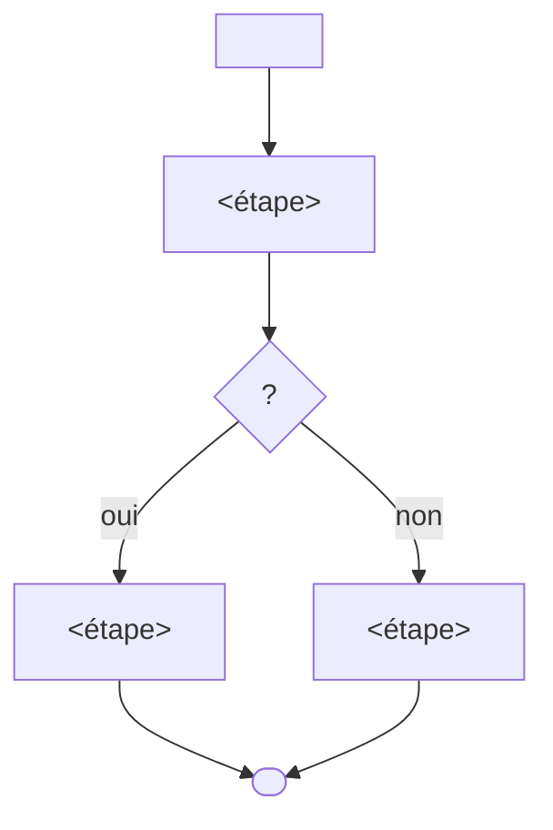

# Logigramme fonctionnel

Il montre le parcours du besoin tel que l'utilisateur le vit : étapes, décisions, variantes, erreurs. Il complète les critères d'acceptation sans les remplacer, et ne répète pas la user story.

## Quand

- **Ticket qui décrit un parcours utilisateur** : produis le logigramme dans le même message que le ticket. Il fait partie de la validation.
- **Ticket sans parcours** (refactoring, infrastructure, correction de libellé) : écris-le en une phrase, sans logigramme.
- **Embranchement inconnu** : pose la question, ou nomme l'hypothèse dans le ticket.

## Contenu

- Une seule case de départ, une case de fin par branche.
- Le cas nominal d'abord, puis les variantes et les erreurs issues des critères d'acceptation.
- Le vocabulaire du produit pour les écrans et les statuts.
- 6 à 12 cases. Jamais le hors-périmètre, un détail d'implémentation ou une donnée inventée.

## Deux représentations, dans cet ordre

**Texte monospace**, lisible dans tous les Jira : le parcours nominal descend d'une case par ligne (`[étape]`, puis `│`, puis `▼`). Une décision s'écrit `{question ?}` et se poursuit par deux branches `├─oui─▶` et `└─non─▶`. Traits et cases partent de la première colonne, pour garantir l'alignement. Chaque case tient sur une ligne, sans emoji ni caractère décoratif.

**Source Mermaid**, pour les équipes qui affichent les diagrammes : un seul bloc `flowchart TD`, des identifiants courts (`A`, `B`, `C`…), des libellés en français entre guillemets, des décisions entre accolades, des branches étiquetées `|oui|` et `|non|`. Il décrit exactement le même parcours, dans le même ordre, que la version texte.

## Où

- Jamais dans la description du ticket.
- En un seul commentaire sur le ticket que tu viens de créer, dont la clé est dans `~/.pm-tickets/created.json`.
- Correction demandée : nouveau commentaire corrigé, sans effacer l'ancien.

## Modèle du commentaire

Utilise exactement ce format, en remplaçant les `<...>` et sans rien ajouter :

````markdown
## Logigramme fonctionnel : <sujet en quelques mots>

**Parcours** : lisible dans tous les Jira.

```text
[<départ>]
│
▼
[<étape>]
│
▼
{<décision> ?}
├─oui─▶ [<étape>] ──▶ [<fin>]
└─non─▶ [<étape>] ──▶ [<fin>]
```

**Source Mermaid** : pour les équipes qui affichent les diagrammes.


````
